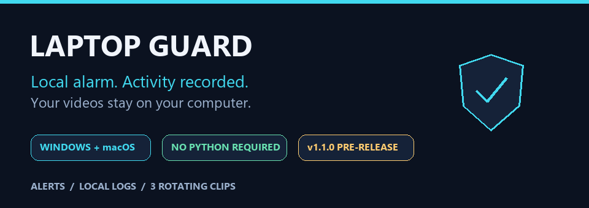
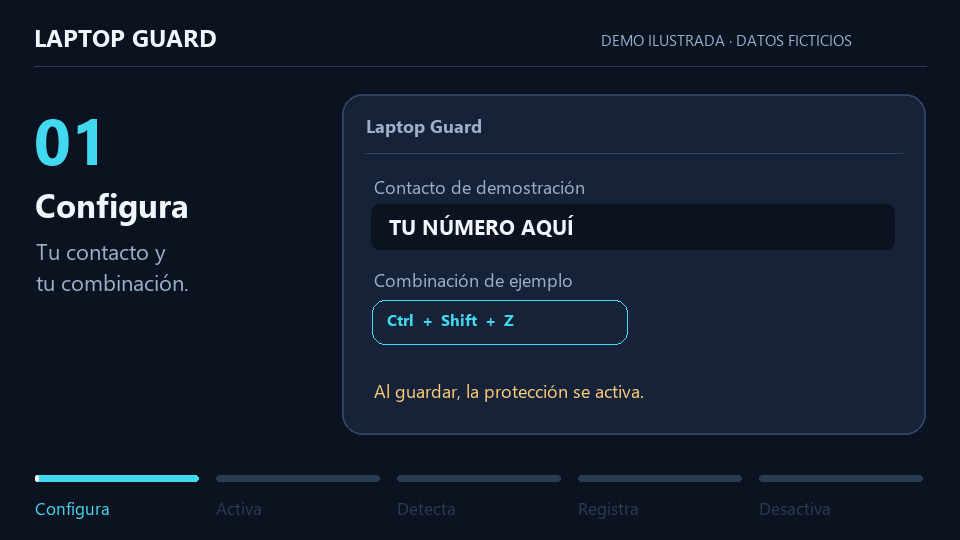

<p align="center">
  
</p>

<p align="center"><a href="README.md">Español</a> · <strong>English</strong></p>

<p align="center">
  <a href="https://github.com/mondragon-developer/laptop-guard/releases/tag/v1.1.0"><strong>Download</strong></a>
  &nbsp; · &nbsp;
  <a href="#-a-15-second-walkthrough">Watch the demo</a>
  &nbsp; · &nbsp;
  <a href="#-getting-started">Get started</a>
  &nbsp; · &nbsp;
  <a href="https://github.com/mondragon-developer/laptop-guard/issues/new">Report an issue</a>
</p>

# A local alarm for when you step away from your laptop

**Laptop Guard** displays a warning and sounds an alarm when someone uses the keyboard or mouse while it is armed. It logs activity and can record a short webcam clip. Your chosen key combination deactivates the guard.

**No account. No uploaded recordings. No Python installation needed for the downloads.**

> 🧪 **v1.1.0 · Testing pre-release.** Test it under supervision before leaving it unattended. This is an alarm and warning overlay; **it does not replace the secure Windows or macOS lock screen**. The on-screen deletion warning is fictional: the program does not delete or encrypt files.

## ⬇️ Download for your computer

| System | Ready-to-run download | Compatibility |
| :--- | :--- | :--- |
| 🟦 **Windows** | [Download Windows x64](https://github.com/mondragon-developer/laptop-guard/releases/download/v1.1.0/LaptopGuard-1.1.0-windows-x64.zip) | Windows 10/11 · 64-bit Intel or AMD |
| 🍎 **Mac · Apple Silicon** | [Download Mac Apple Silicon](https://github.com/mondragon-developer/laptop-guard/releases/download/v1.1.0/LaptopGuard-1.1.0-macos-apple-silicon.zip) | macOS 15+ · M1 or newer |
| 🍎 **Mac · Intel** | [Download Mac Intel](https://github.com/mondragon-developer/laptop-guard/releases/download/v1.1.0/LaptopGuard-1.1.0-macos-intel.zip) | macOS 15+ · Intel processor |

On Mac, open ** → About This Mac** to identify your processor. Windows ARM and older macOS versions have not been validated for these packages.

Each ZIP contains the application and a short guide. Matching SHA-256 checksums are available on the [release page](https://github.com/mondragon-developer/laptop-guard/releases/tag/v1.1.0). Choose one of the app ZIPs to use Laptop Guard; **Source code** downloads are for developers.

## 🎬 A 15-second walkthrough

[](https://github.com/mondragon-developer/laptop-guard/releases/download/v1.1.0/LaptopGuard-1.1.0-demo.mp4)

**[Watch or download the MP4](https://github.com/mondragon-developer/laptop-guard/releases/download/v1.1.0/LaptopGuard-1.1.0-demo.mp4)** · Silent illustrated walkthrough with fictional data and Spanish labels: Configure → Arm → Detect → Log → Disarm. It does not capture a desktop or people, and it illustrates behavior rather than the exact window design.

## 🚀 Getting started

1. **Download and unzip** the package for your system. On Windows, use a folder where you can save files. On Mac, move `LaptopGuard.app` to **Applications**.
2. **Open the app.** On first launch, choose **Probar sin bloquear** (“Test without locking”) to check screens, sound, and camera separately. Camera-test clips are temporary.
3. **Choose `Customize…`.** Enter your own contact number and choose an unlock combination. **Saving arms the guard.** The default is **Ctrl + Shift + Z**; on Mac, Ctrl means **Control**, not Command.
4. **Disarm with your combination.** It stops the alarm and releases input. Later launches show a five-second countdown: you can activate, open **Settings**, run tests, or close the window.

### First-launch permissions

The applications do not have a verified publisher certificate. Windows may display **SmartScreen**, and macOS may require **Privacy & Security → Open Anyway**. Continue only if you trust the download from this repository. Managed computers may block unsigned applications.

On Mac, grant **Accessibility** and, if you want recordings, **Camera** access. If an update leaves Accessibility access unrecognized, remove the old LaptopGuard entry and authorize the app again. The included guide explains these steps.

**Emergency exit:** on Windows, `Ctrl + Alt + Del → Sign out`; on Mac, `Cmd + Option + Esc → Force Quit` LaptopGuard. Signing out may affect other open applications.

## ✨ What's included

| Feature | Windows | macOS |
| :--- | :---: | :---: |
| Alarm, warning, and unlock combination | ✅ | ✅ |
| Persistent activity log | ✅ | ✅ |
| Up to three rotating webcam clips | ✅ | ✅ |
| Tests without blocking keyboard or mouse | ✅ | ✅ |
| Warning on all monitors, including layout changes | ✅ | One screen |
| Optional activation after 15 idle minutes | ✅ | — |
| Recovery of Windows shutdown/restart events | ✅ | — |

**Automatic mode on Windows:** after configuring the app, reopen it and click **Automático (15 minutos)** during the countdown. Enable or pause the watcher there; a cancellable ten-second warning appears before it arms. The portable download **does not install a Windows startup entry**: reopen these controls after signing in.

**Remote work:** file access and terminal commands through VS Code Tunnels or Desktop Commander, and requests to a model server, can continue. The 15-minute timer tracks input in the laptop's session. Tools that simulate desktop clicks or keystrokes may trigger the alarm.

## 🔐 Your data stays with you

- **Your settings:** source defaults contain a placeholder contact, not the author's personal number. Set your own contact in Settings. The demo uses fictional text only.
- **Local history:** `logs/guard.jsonl` records activation, input attempts, deactivation, and video results. Typed characters and the unlock combination are not stored in that activity history.
- **Three clips:** `videos/intruder_1`, `intruder_2`, and `intruder_3` rotate when a valid new clip is saved. A failed recording preserves earlier clips. Set the recording duration to `0` to disable the camera.
- **No personal data in the distribution:** local settings, logs, videos, and the personal voice prototype are excluded from Git and release packages.

Portable Windows builds store data beside the executable. Mac builds use `~/Library/Application Support/LaptopGuard`. Historical logs are not automatically deleted; archive them when needed. A sudden power loss may prevent the last event from being saved; an unexplained interruption is not presented as proof of who shut down the computer.

See the [storage and diagnostics details (Spanish)](docs/RUNTIME.md). Before posting logs publicly, review any system information they may contain.

## 🧩 Technology and dependencies

The downloads include everything needed to run the app. This table is for people who want to understand or modify the project.

| Component | Version in this release | Purpose |
| :--- | :--- | :--- |
| **Python** | Built with 3.12 | Application logic |
| **Tkinter** | Standard library | Windows, settings, and diagnostics |
| **pynput** | 1.8.2 | Global input and unlock-combination detection |
| **OpenCV** | 4.12.0.88 | Clip recording and validation |
| **NumPy** | 2.2.6 | Video dependency and Mac alarm tone generation |
| **winsound + ctypes** | Standard library · Windows | Alarm and Windows APIs |
| **pygame** | 2.6.1 · Mac only | Alarm playback |
| **PyInstaller** | 6.19.0 · build tool | Applications that do not require Python to be installed |

Separate modules handle input, screens, audio, video, and logs. No database or cloud service is added. Dependency versions are pinned in [requirements.txt](requirements.txt).

## 🛠️ Development

<details>
<summary><strong>Run from source, validate, and build</strong></summary>

Use Python 3.10 or newer with Tkinter; release builds are validated with Python 3.12. From the repository folder:

```sh
python -m pip install -r requirements.txt
python guard_app.py --test
```

`--test` opens diagnostics without arming the guard. For normal startup, run `python guard_app.py`; once configured, normal startup arms the guard after five seconds.

```sh
python -m unittest discover -s tests -v
python guard_app.py --check
python -m pip install pyinstaller==6.19.0
python -m PyInstaller laptop_guard.spec --clean --noconfirm
```

**49 automated tests** passed on Windows x64, Mac Apple Silicon, and Mac Intel for the published binary candidate. Each packaged app also passed startup and ZIP-integrity checks. Tests use simulated input and cameras; they do not replace supervised testing of permissions, sound, and camera access on real hardware.

```text
guard_app.py / guard_setup.py   Launcher and settings
laptop_guard.py                Guard orchestration
guard_runtime/                 Runtime helpers, screens, logs, and video
tests/                         Hardware-free regression tests
tools/                         Packaging and illustrated demo
release/                       Guides and release notes
docs/                          Documentation and visual assets
```

Generate the illustrated demo with `python tools/render_readme_demo.py`. Pillow and FFmpeg are used only to create presentation media; they are not new application dependencies.

See the [release process](docs/RELEASING.md), [build workflow](.github/workflows/release.yml), and [roadmap](docs/ROADMAP.md).

</details>

---

**Found a problem?** [Open an issue](https://github.com/mondragon-developer/laptop-guard/issues/new) with your operating system, processor, version, and reproduction steps. Do not post your contact number, unlock combination, private videos, or unreviewed logs.
