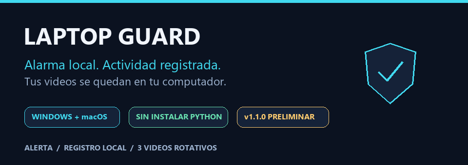

<p align="center">
  
</p>

<p align="center">
  <a href="https://github.com/mondragon-developer/laptop-guard/releases/tag/v1.1.0"><strong>Descargar</strong></a>
  &nbsp; · &nbsp;
  <a href="#-en-15-segundos">Ver demostración</a>
  &nbsp; · &nbsp;
  <a href="#-primeros-pasos">Empezar</a>
  &nbsp; · &nbsp;
  <a href="https://github.com/mondragon-developer/laptop-guard/issues/new">Reportar un problema</a>
</p>

# Una alarma para cuando te alejas de tu laptop

**Laptop Guard** muestra un aviso y hace sonar una alarma cuando alguien usa el teclado o el mouse mientras está activado. Registra los eventos y puede guardar un clip corto de la cámara. Tu combinación de teclas detiene la protección.

**Sin cuenta. Sin subir grabaciones. Sin instalar Python para usar las descargas.**

> 🧪 **v1.1.0 · Versión preliminar para pruebas.** Pruébala primero de forma supervisada. Es una alarma con una pantalla de aviso; **no sustituye el bloqueo seguro de Windows o macOS**. El mensaje disuasorio de la pantalla es ficticio: el programa no borra ni cifra archivos.

## ⬇️ Descarga para tu computador

| Sistema | Archivo listo para abrir | Compatibilidad |
| :--- | :--- | :--- |
| 🟦 **Windows** | [Descargar Windows x64](https://github.com/mondragon-developer/laptop-guard/releases/download/v1.1.0/LaptopGuard-1.1.0-windows-x64.zip) | Windows 10/11 · Intel o AMD de 64 bits |
| 🍎 **Mac · Apple Silicon** | [Descargar Mac Apple Silicon](https://github.com/mondragon-developer/laptop-guard/releases/download/v1.1.0/LaptopGuard-1.1.0-macos-apple-silicon.zip) | macOS 15+ · M1 o posterior |
| 🍎 **Mac · Intel** | [Descargar Mac Intel](https://github.com/mondragon-developer/laptop-guard/releases/download/v1.1.0/LaptopGuard-1.1.0-macos-intel.zip) | macOS 15+ · procesador Intel |

En Mac, abre ** → Acerca de este Mac** para identificar el procesador. Windows ARM y versiones anteriores de macOS no están validados para estos paquetes.

Cada ZIP contiene la aplicación y una guía breve. En el [release](https://github.com/mondragon-developer/laptop-guard/releases/tag/v1.1.0) encontrarás también su comprobación SHA-256. Para usar la app, elige uno de estos ZIP; **Source code** es para quienes desean trabajar con el código.

## 🎬 En 15 segundos

[](https://github.com/mondragon-developer/laptop-guard/releases/download/v1.1.0/LaptopGuard-1.1.0-demo.mp4)

**[Ver o descargar el video MP4](https://github.com/mondragon-developer/laptop-guard/releases/download/v1.1.0/LaptopGuard-1.1.0-demo.mp4)** · Recorrido ilustrado, sin audio y con datos ficticios. No es una captura del escritorio ni una grabación de personas; representa el funcionamiento, no el diseño exacto de las ventanas.

## 🚀 Primeros pasos

1. **Descarga y descomprime** el ZIP de tu sistema. En Windows, usa una carpeta donde puedas guardar archivos. En Mac, mueve `LaptopGuard.app` a **Aplicaciones**.
2. **Abre la aplicación.** En el primer inicio puedes elegir **Probar sin bloquear** para comprobar pantallas, sonido y cámara por separado. Los videos de prueba son temporales.
3. **Personaliza con `Customize…`.** Introduce tu propio número de contacto y elige tu combinación para desactivar. **Al guardar, la protección se activa.** La combinación predeterminada es **Ctrl + Shift + Z**; en Mac, Ctrl significa **Control**, no Command.
4. **Vuelve con tu combinación.** Al presionarla, se detiene la alarma y se libera la entrada. En las siguientes aperturas hay una cuenta regresiva de cinco segundos: puedes activar, abrir **Settings**, probar o cerrar la ventana.

### Al abrir por primera vez

Las aplicaciones no tienen certificado de editor verificado. Windows puede mostrar **SmartScreen** y macOS puede pedir **Privacidad y seguridad → Abrir de todos modos**. Continúa solo si confías en la descarga de este repositorio. Un computador administrado puede impedir la ejecución de aplicaciones sin firma.

En Mac, concede **Accesibilidad** y, si usarás grabación, **Cámara**. Si una actualización deja de reconocer Accesibilidad, elimina la entrada anterior de LaptopGuard y vuelve a autorizar la app. La guía incluida explica estos pasos.

**Salida de emergencia:** en Windows, `Ctrl + Alt + Del → Cerrar sesión`; en Mac, `Cmd + Option + Esc → Forzar salida` de LaptopGuard. Cerrar sesión puede afectar otras aplicaciones abiertas.

## ✨ Lo que incluye

| Función | Windows | macOS |
| :--- | :---: | :---: |
| Alarma, aviso y combinación de desactivación | ✅ | ✅ |
| Registro de eventos persistente | ✅ | ✅ |
| Hasta tres clips de cámara, con rotación | ✅ | ✅ |
| Pruebas sin bloquear teclado o mouse | ✅ | ✅ |
| Aviso en todas las pantallas y cambios de monitores | ✅ | Una pantalla |
| Activación opcional tras 15 minutos de inactividad | ✅ | — |
| Recuperación de eventos de apagado/reinicio de Windows | ✅ | — |

**Automático en Windows:** después de configurar la app, vuelve a abrirla y pulsa **Automático (15 minutos)** durante la cuenta regresiva. Puedes activar o pausar la vigilancia; antes de proteger aparece un aviso cancelable de diez segundos. La descarga portátil **no instala un inicio automático con Windows**: vuelve a abrir estos controles después de iniciar sesión.

**Trabajo remoto:** los archivos y comandos de VS Code Tunnels, Desktop Commander y las peticiones a un servidor de modelos pueden seguir funcionando. Los 15 minutos se calculan a partir de la entrada en la sesión del laptop. Las herramientas que simulan clics o teclas en su escritorio sí pueden disparar la alarma.

## 🔐 Tus datos se quedan contigo

- **Configuración propia:** el código usa un contacto de ejemplo, nunca el número personal del autor. Elige tu contacto en Settings. La demo usa únicamente texto ficticio.
- **Historial local:** `logs/guard.jsonl` registra activación, intentos de entrada, desactivación y resultados de video. Los caracteres escritos y la combinación de desactivación no se guardan en ese historial.
- **Tres videos:** `videos/intruder_1`, `intruder_2` e `intruder_3` rotan cuando se guarda un clip válido. Si falla la grabación, se conservan los clips anteriores. Puedes deshabilitar la cámara configurando su duración en `0`.
- **Sin datos personales en la distribución:** configuraciones locales, logs, videos y el prototipo personal de voz están excluidos de Git y de los paquetes.

En Windows portátil, los datos se guardan junto al ejecutable. En Mac están en `~/Library/Application Support/LaptopGuard`. Los logs no se borran automáticamente: puedes archivarlos cuando lo necesites. Un corte de energía puede impedir guardar el último evento; una interrupción desconocida no se presenta como prueba de quién apagó el equipo.

Consulta los [detalles de almacenamiento y diagnóstico](docs/RUNTIME.md). Antes de adjuntar logs a un reporte público, revisa cualquier dato del sistema que puedan contener.

## 🧩 Tecnología y dependencias

Todo lo necesario viene incluido en los ZIP. Esta tabla es para quienes desean entender o modificar el proyecto.

| Componente | Versión de esta entrega | Función |
| :--- | :--- | :--- |
| **Python** | Builds con 3.12 | Lógica de la aplicación |
| **Tkinter** | Biblioteca estándar | Ventanas, configuración y pruebas |
| **pynput** | 1.8.2 | Entrada global y combinación de desactivación |
| **OpenCV** | 4.12.0.88 | Grabación y validación de clips |
| **NumPy** | 2.2.6 | Dependencia de video y generación del tono en Mac |
| **winsound + ctypes** | Biblioteca estándar · Windows | Alarma y acceso a APIs de Windows |
| **pygame** | 2.6.1 · solo Mac | Reproducción de la alarma |
| **PyInstaller** | 6.19.0 · compilación | Aplicaciones que no requieren instalar Python |

Los módulos separan entrada, pantallas, audio, video y registros. No se añade una base de datos ni un servicio de nube. Las versiones están fijadas en [requirements.txt](requirements.txt).

## 🛠️ Para desarrollar

<details>
<summary><strong>Ejecutar desde el código, validar y compilar</strong></summary>

Usa Python 3.10 o posterior con Tkinter; las distribuciones se validan con Python 3.12. Desde la carpeta del repositorio:

```sh
python -m pip install -r requirements.txt
python guard_app.py --test
```

`--test` abre las pruebas sin activar el bloqueo. Para el inicio normal, ejecuta `python guard_app.py`; después de configurar el programa, el inicio normal activa la protección tras cinco segundos.

```sh
python -m unittest discover -s tests -v
python guard_app.py --check
python -m pip install pyinstaller==6.19.0
python -m PyInstaller laptop_guard.spec --clean --noconfirm
```

**49 pruebas automáticas** pasaron en Windows x64, Mac Apple Silicon y Mac Intel para la candidata binaria. También se comprobó el arranque de cada app empaquetada y la integridad de los ZIP. Las pruebas usan entradas y cámara simuladas: no sustituyen la prueba supervisada de permisos, sonido y cámara en un equipo real.

```text
guard_app.py / guard_setup.py   Inicio y configuración
laptop_guard.py                Coordinación de la protección
guard_runtime/                 Entrada auxiliar, pantalla, logs y videos
tests/                         Pruebas sin hardware real
tools/                         Empaquetado y demo ilustrada
release/                       Guías y notas de versión
docs/                          Documentación y recursos visuales
```

La demo se genera con `python tools/render_readme_demo.py`. Pillow y FFmpeg se usan solo para crear material de presentación; no son dependencias nuevas de la app.

Consulta [cómo preparar releases](docs/RELEASING.md), el [flujo de compilación](.github/workflows/release.yml) y el [plan de mejoras](docs/ROADMAP.md).

</details>

---

**¿Encontraste un problema?** [Abre un reporte](https://github.com/mondragon-developer/laptop-guard/issues/new) indicando sistema, procesador, versión y pasos para reproducirlo. No publiques tu teléfono, combinación, videos privados ni logs sin revisarlos.
